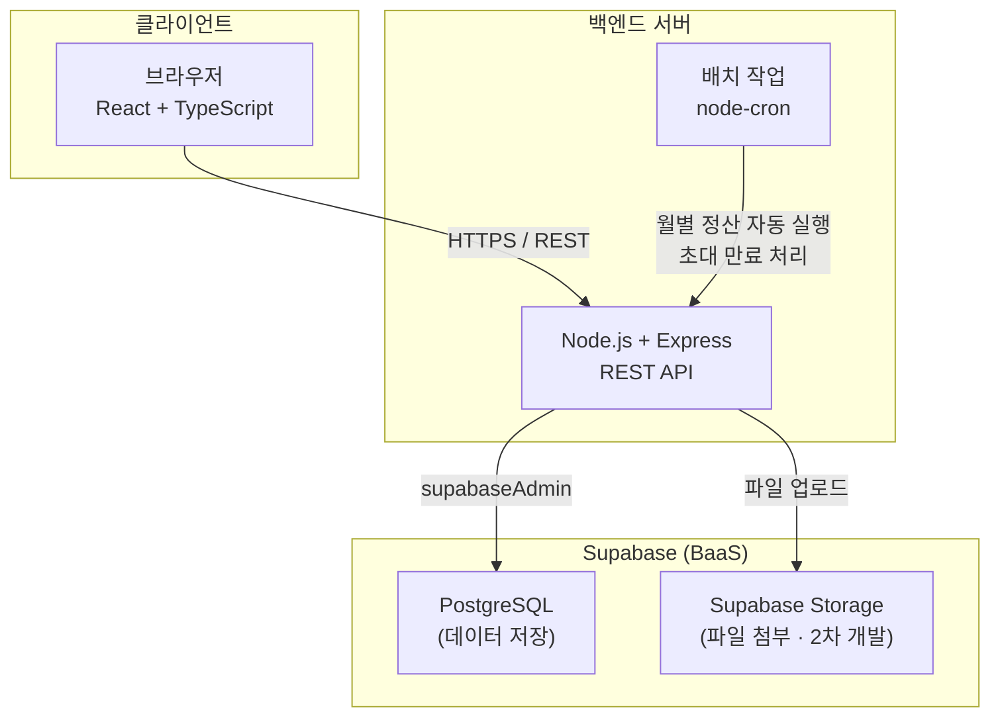
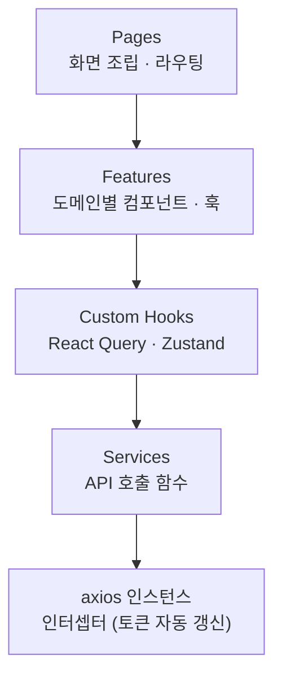
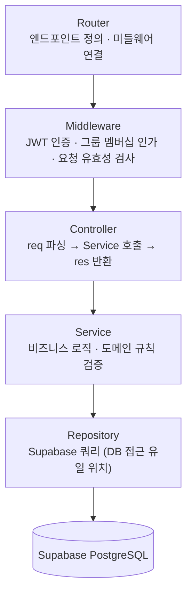
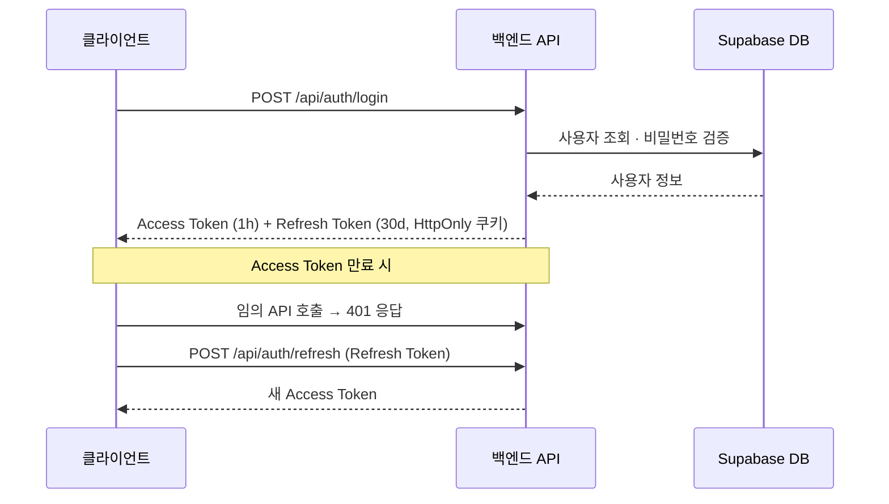
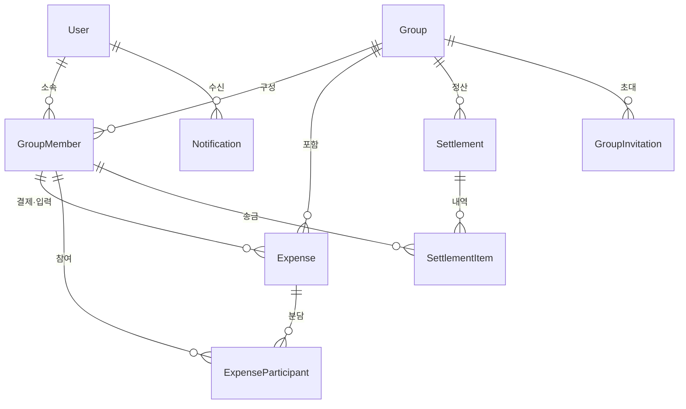
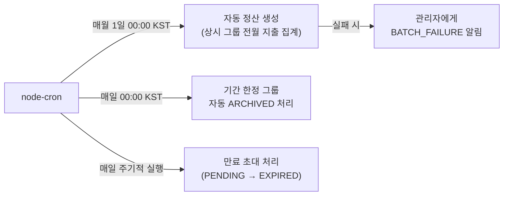

# 기술 아키텍처 다이어그램 — 공동 가계부 서비스

**버전:** 1.0  
**작성일:** 2026-06-18  
**참조 문서:** `docs/1-domain-definition.md`, `docs/2-prd.md`, `docs/4-project-principle.md`

---

## 1. 시스템 전체 구성

---

## 2. 프론트엔드 레이어

> 컴포넌트는 훅을 경유하여 서비스를 호출한다. 서비스를 직접 호출하지 않는다.

---

## 3. 백엔드 레이어

---

## 4. 인증 흐름

---

## 5. 도메인 엔티티 관계

---

## 6. 배치 작업 스케줄

