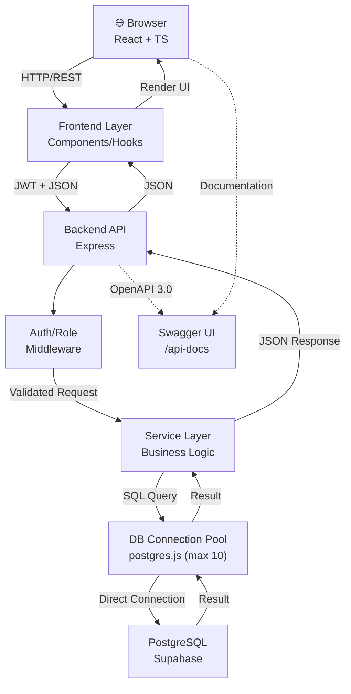
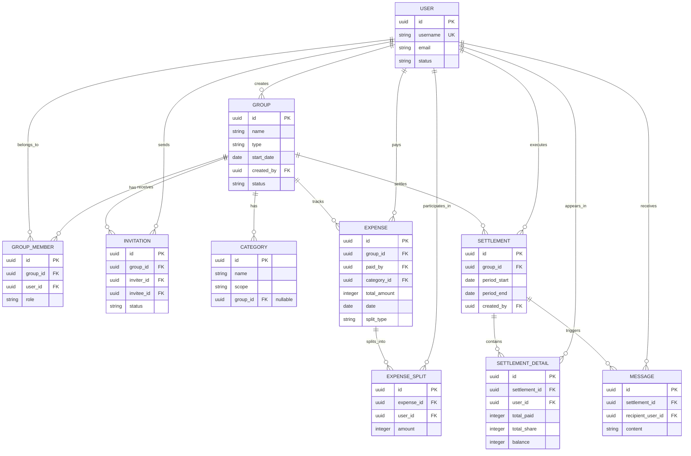
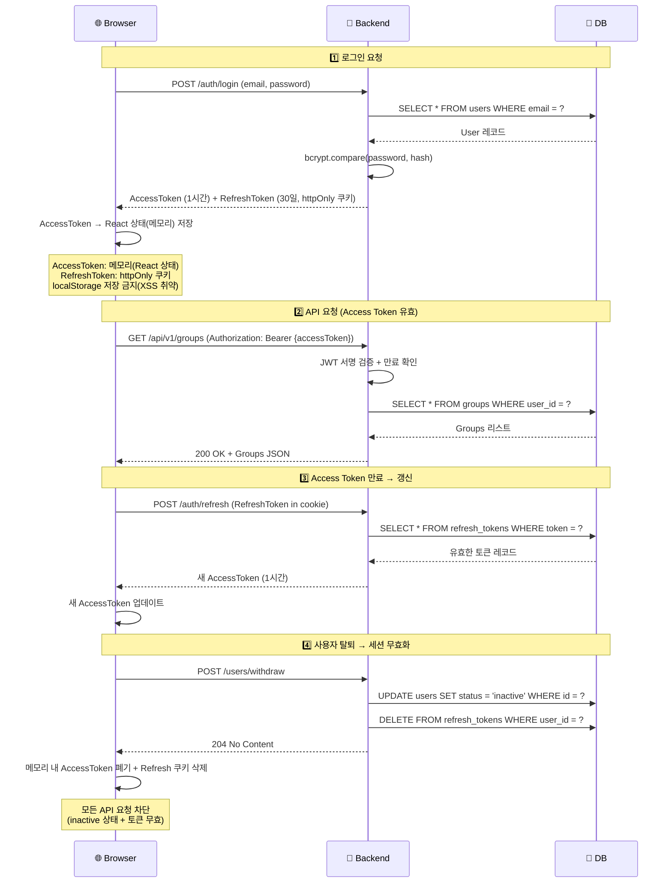
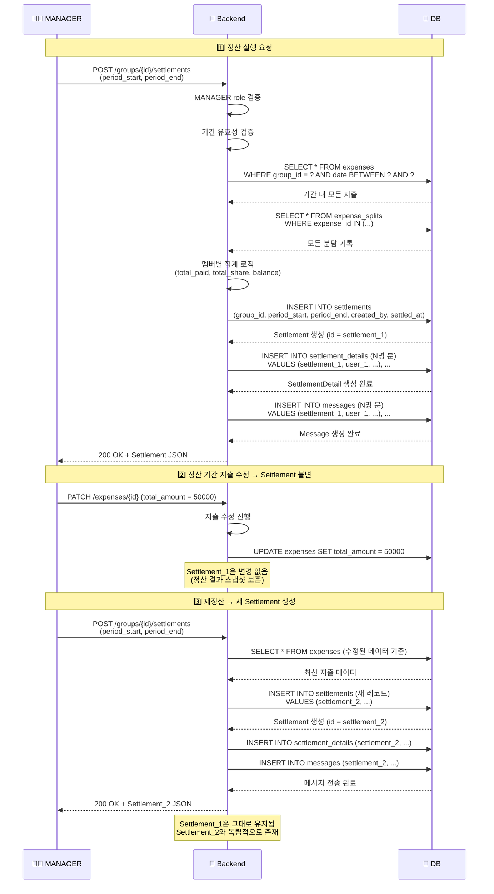
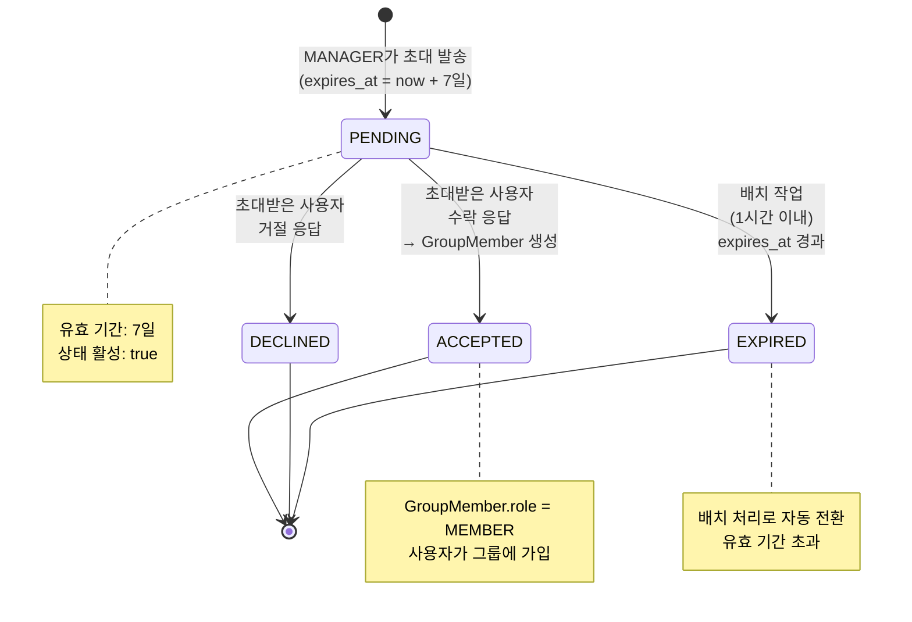

# 기술 아키텍처 다이어그램 — 공동 가계부 서비스

> 버전: 1.2  
> 작성일: 2026-06-18  
> 관련 문서: [1-domain-definition.md](1-domain-definition.md) · [2-prd.md](2-prd.md) · [3-user-scenario.md](3-user-scenario.md) · [4-project-principle.md](4-project-principle.md)

---

## 목차

1. [전체 시스템 아키텍처](#1-전체-시스템-아키텍처)
2. [엔티티 관계도 (ERD)](#2-엔티티-관계도-erd)
3. [인증 흐름](#3-인증-흐름)
4. [정산 실행 흐름](#4-정산-실행-흐름)
5. [초대 상태 전이](#5-초대-상태-전이)

---

## 1. 전체 시스템 아키텍처

클라이언트 요청이 프론트엔드 → 백엔드 REST API → Supabase 데이터베이스를 거쳐 처리되는 전체 흐름을 표현합니다.

> v1 범위: 영수증·사진 첨부 미지원(SC-02). 파일 스토리지는 Out-of-Scope.

---

## 2. 엔티티 관계도 (ERD)

10개 도메인 엔티티와 그 간 관계를 PK/FK 기준으로 표현합니다. 카디널리티는 |o, ||, o{, }o 기호로 표시합니다.

---

## 3. 인증 흐름

로그인 시 Access Token과 Refresh Token 발급, API 요청 시 토큰 검증, 만료 시 갱신, 탈퇴 시 토큰 무효화 흐름을 표현합니다.

---

## 4. 정산 실행 흐름

MANAGER가 정산을 실행하면, 기간 내 지출을 집계하여 Settlement/SettlementDetail 생성, 메시지 발송, 재정산 시 새 레코드 생성 흐름을 표현합니다.

---

## 5. 초대 상태 전이

사용자 초대의 라이프사이클: PENDING → ACCEPTED/DECLINED/EXPIRED 상태 전이를 표현합니다.

---

## 변경 이력

| 버전 | 일자 | 변경 내용 | 작성자 |
|------|------|----------|--------|
| 1.2 | 2026-06-18 | (1) 시스템 아키텍처: DB 접근 방식을 @supabase/supabase-js(Supabase REST API) → postgres.js 직접 연결로 변경. DB Connection Pool(max 10) 노드 추가, SQL Query 흐름 명시. (2) ERD: Invitation.invitee_username → invitee_id(UUID FK → User.id) 변경. (3) Swagger UI 엔드포인트(/api-docs) 및 OpenAPI 3.0 흐름 아키텍처에 추가. | stepanowon |
| 1.1 | 2026-06-18 | (1) 시스템 아키텍처에서 Supabase Storage 노드 및 Upload/Download 흐름 제거 (SC-02 Out-of-Scope 반영). (2) 인증 흐름에서 AccessToken 저장 방식을 localStorage → React 상태(메모리)로 수정 (XSS 취약성 방지, 4-project-principle 보안 원칙 일치). (3) Backend 명칭 Express.js → Express 통일. | stepanowon |
| 1.0 | 2026-06-18 | 최초 작성: 전체 시스템 아키텍처, ERD, 인증 흐름, 정산 실행 흐름, 초대 상태 전이 | stepanowon |
