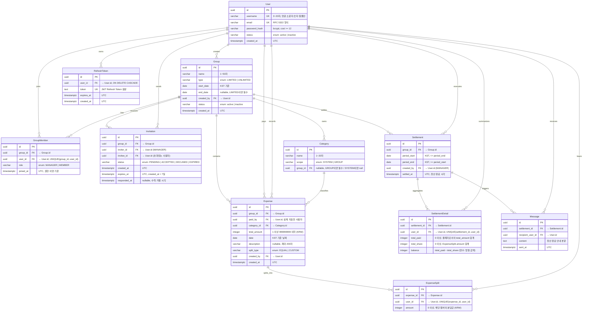

# ERD (Entity Relationship Diagram) — 공동 가계부 서비스

> 버전: 1.4
> 작성일: 2026-06-18
> 수정일: 2026-10-18
> 관련 문서: 1-domain-definition.md · 2-prd.md · 5-arch-diagram.md

---

## 목차
1. [전체 ERD](#1-전체-erd)
2. [엔티티 상세 설명](#2-엔티티-상세-설명)
3. [주요 관계 설명](#3-주요-관계-설명)
4. [변경 이력](#4-변경-이력)

---

## 1. 전체 ERD



---

## 2. 엔티티 상세 설명

> **타입 표기 참고**: `status`, `type`, `role`, `scope`, `split_type` 컬럼은 `database/schema.sql`에서 PostgreSQL ENUM 타입(`user_status`, `group_status`, `group_type`, `member_role`, `invitation_status`, `category_scope`, `split_type`)으로 정의된다. 아래 표의 `varchar` + `CHECK (... IN (...))` 표기는 ENUM의 허용값을 나타내는 논리적 표현이며, 실제 DB에서는 ENUM 타입이 값 범위를 제한한다.

### 2.1 users

> 서비스에 가입한 사용자. 물리 삭제 없이 `status`로 탈퇴 여부를 관리한다.

| 컬럼명 | PostgreSQL 타입 | 제약 | 설명 |
|--------|----------------|------|------|
| `id` | `uuid` | PK, NOT NULL, DEFAULT gen_random_uuid() | 내부 식별자 |
| `username` | `varchar(20)` | UNIQUE, NOT NULL, CHECK (username ~ '^[a-z0-9_]{3,20}$') | 서비스 내 공개 식별자. 멤버 초대 시 검색 기준 |
| `email` | `varchar(255)` | UNIQUE, NOT NULL | 로그인용 이메일 (RFC 5322) |
| `password_hash` | `varchar(255)` | NOT NULL | bcrypt 해시값 (cost factor ≥ 12) |
| `status` | `varchar(10)` | NOT NULL, DEFAULT 'active', CHECK (status IN ('active', 'inactive')) | `active` \| `inactive`. 탈퇴 시 `inactive` 전환 |
| `created_at` | `timestamptz` | NOT NULL, DEFAULT now() | 가입 시각 (UTC) |

**비즈니스 규칙 참조**
- DR-01: `username`은 서비스 전체에서 고유
- BR-12: 탈퇴 시 `inactive` 전환, 물리 삭제 없음. 기존 지출 기록 보존
- NFR-SEC07: 탈퇴 즉시 모든 Refresh Token 무효화

---

### 2.2 groups

> 공동 지출을 관리하는 기본 단위. `LIMITED`(기간 한정)와 `UNLIMITED`(상시) 두 타입을 지원한다.

| 컬럼명 | PostgreSQL 타입 | 제약 | 설명 |
|--------|----------------|------|------|
| `id` | `uuid` | PK, NOT NULL, DEFAULT gen_random_uuid() | 내부 식별자 |
| `name` | `varchar(50)` | NOT NULL, CHECK (char_length(name) >= 1) | 그룹 이름 (1~50자) |
| `type` | `varchar(10)` | NOT NULL, CHECK (type IN ('LIMITED', 'UNLIMITED')) | `LIMITED` \| `UNLIMITED` |
| `start_date` | `date` | NOT NULL | 그룹 시작일 (KST 기준) |
| `end_date` | `date` | NULL 허용 | 그룹 종료일 (KST). `LIMITED`이면 필수, `UNLIMITED`이면 null |
| `created_by` | `uuid` | NOT NULL, FK → users.id ON DELETE RESTRICT | 그룹 최초 생성자 |
| `status` | `varchar(10)` | NOT NULL, DEFAULT 'active', CHECK (status IN ('active', 'inactive')) | `active` \| `inactive`. 비활성화 시 조회만 가능 |
| `created_at` | `timestamptz` | NOT NULL, DEFAULT now() | 생성 시각 (UTC) |

**비즈니스 규칙 참조**
- BR-02: `LIMITED` 또는 `UNLIMITED` 타입으로 생성
- DR-03: `LIMITED`이면 `end_date >= start_date` 필수. DB CHECK `chk_limited_end_date`(`type <> 'LIMITED' OR (end_date IS NOT NULL AND end_date >= start_date)`)로 강제하며, 입력 단계에서는 zod `superRefine`이 422로 검증한다. `UNLIMITED`의 `end_date`는 서버가 별도로 null로 정리하지 않는다(프론트가 `UNLIMITED` 선택 시 null 전송).
- BR-14: 활성 멤버가 없는 그룹은 자동으로 `inactive` 전환

---

### 2.3 group_members

> 그룹 내 사용자의 소속 및 역할 정보. `(group_id, user_id)` 복합 유니크 제약으로 중복 가입을 방지한다.

| 컬럼명 | PostgreSQL 타입 | 제약 | 설명 |
|--------|----------------|------|------|
| `id` | `uuid` | PK, NOT NULL, DEFAULT gen_random_uuid() | 내부 식별자 |
| `group_id` | `uuid` | NOT NULL, FK → groups.id ON DELETE RESTRICT | 소속 그룹 |
| `user_id` | `uuid` | NOT NULL, FK → users.id ON DELETE RESTRICT | 소속 사용자 |
| `role` | `varchar(10)` | NOT NULL, CHECK (role IN ('MANAGER', 'MEMBER')) | `MANAGER` \| `MEMBER` |
| `joined_at` | `timestamptz` | NOT NULL, DEFAULT now() | 그룹 참여 시각 (UTC). MANAGER 이양 시 기준값 |

**복합 제약**: `UNIQUE(group_id, user_id)`

**비즈니스 규칙 참조**
- DR-02: `(group_id, user_id)` 조합 유일
- BR-13: MANAGER 탈퇴 시 `joined_at` 기준 최선임 활성 MEMBER에게 권한 자동 이양
- BR-01: 한 사용자는 여러 그룹에 동시 소속 가능

---

### 2.4 invitations

> 그룹 멤버 초대의 라이프사이클 관리. `PENDING → ACCEPTED | DECLINED | EXPIRED` 상태 전이를 추적한다.

| 컬럼명 | PostgreSQL 타입 | 제약 | 설명 |
|--------|----------------|------|------|
| `id` | `uuid` | PK, NOT NULL, DEFAULT gen_random_uuid() | 내부 식별자 |
| `group_id` | `uuid` | NOT NULL, FK → groups.id ON DELETE RESTRICT | 초대 대상 그룹 |
| `inviter_id` | `uuid` | NOT NULL, FK → users.id ON DELETE RESTRICT | 초대한 사용자 (MANAGER) |
| `invitee_id` | `uuid` | NOT NULL, FK → users.id ON DELETE RESTRICT | 초대받는 사용자 |
| `status` | `varchar(10)` | NOT NULL, DEFAULT 'PENDING', CHECK (status IN ('PENDING', 'ACCEPTED', 'DECLINED', 'EXPIRED')) | `PENDING` \| `ACCEPTED` \| `DECLINED` \| `EXPIRED` |
| `created_at` | `timestamptz` | NOT NULL, DEFAULT now() | 초대 생성 시각 (UTC) |
| `expires_at` | `timestamptz` | NOT NULL, CHECK (expires_at > created_at) | 초대 만료 시각 (UTC). `created_at + 7일` |
| `responded_at` | `timestamptz` | NULL 허용 | 수락·거절 시각 (UTC). **현재 애플리케이션이 값을 기록하지 않아 항상 NULL** (컬럼만 존재) |

**비즈니스 규칙 참조**
- BR-03: MANAGER만 초대 발송 가능. `username`으로 사용자 조회 후 `invitee_id`(uuid)로 저장
- FR-I02: 초대 유효기간 7일. 서버 내 30분 주기 `setInterval` 잡(`jobs/invitationExpiry.job.ts`)이 DB 함수 `expire_pending_invitations()`를 호출해 `EXPIRED`로 전환 (NFR-A04). 수락·거절 응답 시점에 `expires_at`이 이미 지났다면 즉시 `EXPIRED`로 갱신하고 422를 반환한다.
- FR-I05: 동일 대상에 `PENDING` 초대 존재 시 중복 초대 차단 (409)

---

### 2.5 categories

> 지출 분류 태그. `SYSTEM`(전체 공통)과 `GROUP`(그룹 전용) 두 가지 scope로 구분된다.

| 컬럼명 | PostgreSQL 타입 | 제약 | 설명 |
|--------|----------------|------|------|
| `id` | `uuid` | PK, NOT NULL, DEFAULT gen_random_uuid() | 내부 식별자 |
| `name` | `varchar(20)` | NOT NULL, CHECK (char_length(name) >= 1) | 카테고리 이름 (1~20자) |
| `scope` | `varchar(10)` | NOT NULL, CHECK (scope IN ('SYSTEM', 'GROUP')) | `SYSTEM` \| `GROUP` |
| `group_id` | `uuid` | NULL 허용, FK → groups.id ON DELETE RESTRICT | 소속 그룹. `GROUP`이면 필수, `SYSTEM`이면 null (`chk_categories_scope_group_id`로 강제) |

**시스템 카테고리 시드 데이터** (`scope = 'SYSTEM'`, `group_id = null`)

| 순서 | 카테고리명 |
|------|-----------|
| 1 | 식비 |
| 2 | 교통 |
| 3 | 숙소 |
| 4 | 쇼핑 |
| 5 | 문화/여가 |
| 6 | 의료 |
| 7 | 기타 |

**비즈니스 규칙 참조**
- BR-10: `SYSTEM` 카테고리는 수정·삭제 불가. 모든 그룹에 공통 제공
- BR-11: `GROUP` 카테고리 삭제 시 해당 지출은 `기타`(SYSTEM)로 자동 재분류. 애플리케이션이 DB 함수 `delete_group_category()`를 호출해 처리한다 (2.12 참고)

---

### 2.6 expenses

> 그룹 내에서 발생한 개별 지출 항목. `paid_by`(결제자)는 분담 대상에 항상 포함된다.

| 컬럼명 | PostgreSQL 타입 | 제약 | 설명 |
|--------|----------------|------|------|
| `id` | `uuid` | PK, NOT NULL, DEFAULT gen_random_uuid() | 내부 식별자 |
| `group_id` | `uuid` | NOT NULL, FK → groups.id ON DELETE RESTRICT | 소속 그룹 |
| `paid_by` | `uuid` | NOT NULL, FK → users.id ON DELETE RESTRICT | 실제 지출한 사용자 (결제자) |
| `category_id` | `uuid` | NOT NULL, FK → categories.id ON DELETE RESTRICT | 지출 카테고리. 삭제 전 애플리케이션 트랜잭션으로 `기타` ID로 UPDATE 후 처리 (BR-11) |
| `total_amount` | `integer` | NOT NULL, CHECK (total_amount >= 1 AND total_amount <= 999999999) | 전체 지출 금액 (KRW) |
| `date` | `date` | NOT NULL | 지출 발생일 (KST 기준, 날짜만) |
| `description` | `varchar(200)` | NULL 허용 | 지출 설명 (최대 200자) |
| `split_type` | `varchar(10)` | NOT NULL, CHECK (split_type IN ('EQUAL', 'CUSTOM')) | `EQUAL` \| `CUSTOM` |
| `created_by` | `uuid` | NOT NULL, FK → users.id ON DELETE RESTRICT | 지출을 입력한 사용자 |
| `created_at` | `timestamptz` | NOT NULL, DEFAULT now() | 입력 시각 (UTC) |

**비즈니스 규칙 참조**
- BR-04: 그룹 내 모든 지출 내역은 멤버 전체에게 공개
- BR-05, BR-06: `EQUAL` 분배 시 나머지는 `paid_by`에게 귀속. 결제자는 항상 분담 대상 포함
- BR-15: 정산 완료 후에도 수정·삭제 가능. 기존 Settlement/SettlementDetail 불변
- DR-04: `CUSTOM` 분담 시 `ExpenseSplit.amount` 합산 = `total_amount` 일치 필수

---

### 2.7 expense_splits

> 지출 항목에 대한 참여 멤버별 분담금. `(expense_id, user_id)` 복합 유니크로 멤버당 1개 레코드를 보장한다.

| 컬럼명 | PostgreSQL 타입 | 제약 | 설명 |
|--------|----------------|------|------|
| `id` | `uuid` | PK, NOT NULL, DEFAULT gen_random_uuid() | 내부 식별자 |
| `expense_id` | `uuid` | NOT NULL, FK → expenses.id ON DELETE CASCADE | 대상 지출. 지출 삭제 시 분담 레코드도 함께 삭제 |
| `user_id` | `uuid` | NOT NULL, FK → users.id ON DELETE RESTRICT | 분담 대상 멤버 |
| `amount` | `integer` | NOT NULL, CHECK (amount >= 0) | 해당 멤버의 분담금 (KRW) |

**복합 제약**: `UNIQUE(expense_id, user_id)`

**비즈니스 규칙 참조**
- BR-05: `EQUAL` 분배 시 나머지(1원) 단위는 결제자(`paid_by`) 몫으로 귀속
- BR-06: 결제자는 참여자 선택 여부와 무관하게 `expense_splits`에 항상 포함
- DR-04: `CUSTOM` 방식에서 `SUM(amount)` = `expenses.total_amount` 이어야 저장 가능

---

### 2.8 settlements

> 특정 기간 동안의 그룹 지출을 집계한 정산 결과. `status` 컬럼 없음 — 생성 즉시 완료 상태이며, 재정산은 새 레코드로 추가된다.

| 컬럼명 | PostgreSQL 타입 | 제약 | 설명 |
|--------|----------------|------|------|
| `id` | `uuid` | PK, NOT NULL, DEFAULT gen_random_uuid() | 내부 식별자 |
| `group_id` | `uuid` | NOT NULL, FK → groups.id ON DELETE RESTRICT | 정산 대상 그룹 |
| `period_start` | `date` | NOT NULL | 정산 시작일 (KST, 해당일 00:00:00 포함) |
| `period_end` | `date` | NOT NULL, CHECK (period_start <= period_end) | 정산 종료일 (KST, 해당일 23:59:59 포함) |
| `created_by` | `uuid` | NOT NULL, FK → users.id ON DELETE RESTRICT | 정산 실행자 (MANAGER) |
| `settled_at` | `timestamptz` | NOT NULL, DEFAULT now() | 정산 완료 시각 (UTC) |

**비즈니스 규칙 참조**
- BR-07: MANAGER만 정산 실행 가능. 기간 직접 지정 (SC-03: 자동 정산 없음)
- DR-05: `period_start <= period_end` 이어야 함
- BR-08: 정산 완료 시 그룹 전 멤버에게 Message 자동 발송
- FR-S04: 재정산은 새 Settlement 레코드 생성. 기존 레코드 불변

---

### 2.9 settlement_details

> 정산 결과에서 멤버별 집계 금액. `balance = total_paid - total_share` 로 받을/낼 금액을 나타낸다.

| 컬럼명 | PostgreSQL 타입 | 제약 | 설명 |
|--------|----------------|------|------|
| `id` | `uuid` | PK, NOT NULL, DEFAULT gen_random_uuid() | 내부 식별자 |
| `settlement_id` | `uuid` | NOT NULL, FK → settlements.id ON DELETE RESTRICT | 소속 정산. 정산 결과 불변(BR-15)으로 CASCADE 삭제 금지 |
| `user_id` | `uuid` | NOT NULL, FK → users.id ON DELETE RESTRICT | 대상 멤버 |
| `total_paid` | `integer` | NOT NULL, CHECK (total_paid >= 0) | 해당 멤버가 결제자인 지출의 `total_amount` 합계 |
| `total_share` | `integer` | NOT NULL, CHECK (total_share >= 0) | 해당 멤버의 `expense_splits.amount` 합계 |
| `balance` | `integer` | GENERATED ALWAYS AS (total_paid - total_share) STORED | `total_paid - total_share`. 양수: 받을 금액, 음수: 내야 할 금액 |

**복합 제약**: `UNIQUE(settlement_id, user_id)`

**비즈니스 규칙 참조**
- DR-06: `balance = total_paid - total_share`. `GENERATED ALWAYS AS (total_paid - total_share) STORED`로 DB에서 자동 계산되어 불일치 원천 차단
- DR-04(CUSTOM 합산 = total_amount)는 다중 행 집계라 DB CHECK로 불가. 서비스 레이어에서 422로 검증 (현재 INSERT들은 단일 DB 트랜잭션으로 묶여 있지 않음)
- AC-S3: 기간 내 지출 0건이어도 그룹 멤버(`group_members`) 수만큼 레코드 생성 (모든 `balance = 0`)

---

### 2.10 messages

> 서비스 내 메시지는 정산 메시지만 허용한다. Settlement 완료 시 그룹 전 멤버에게 자동 생성된다.

| 컬럼명 | PostgreSQL 타입 | 제약 | 설명 |
|--------|----------------|------|------|
| `id` | `uuid` | PK, NOT NULL, DEFAULT gen_random_uuid() | 내부 식별자 |
| `settlement_id` | `uuid` | NOT NULL, FK → settlements.id ON DELETE RESTRICT | 연계된 정산 |
| `recipient_user_id` | `uuid` | NOT NULL, FK → users.id ON DELETE RESTRICT | 수신 멤버 |
| `content` | `text` | NOT NULL | 메시지 본문 (정산 완료 안내와 정산 기간) |
| `sent_at` | `timestamptz` | NOT NULL, DEFAULT now() | 발송 시각 (UTC) |

**메시지 포함 내용** (FR-M01, 섹션 8.1)

현재 구현은 모든 수신자에게 동일한 안내 문구를 보낸다. 개인별 금액은 정산 상세에서 확인한다.

| 항목 | 예시 |
|------|------|
| 안내 문구 + 정산 기간 | 정산이 완료되었습니다. (기간: 2026-06-15 ~ 2026-06-18) |

그룹명, 내 지불 금액, 내 분담금, 차액은 메시지 본문에 포함되지 않는다.

**비즈니스 규칙 참조**
- BR-08: 정산 완료 시 그룹 전 멤버에게 자동 발송 (NFR-A03: 1분 이내 보장)
- BR-09: 서비스 내 메시지는 정산 메시지만 허용. 임의 발송 API 미제공

---

### 2.11 refresh_tokens

> 로그인 시 발급한 Refresh Token 저장소. 토큰 갱신 시 기존 행을 삭제하고 새 행을 만든다(회전). 로그아웃·탈퇴 시 삭제된다.

| 컬럼명 | PostgreSQL 타입 | 제약 | 설명 |
|--------|----------------|------|------|
| `id` | `uuid` | PK, NOT NULL, DEFAULT gen_random_uuid() | 내부 식별자 |
| `user_id` | `uuid` | NOT NULL, FK → users.id ON DELETE CASCADE | 토큰 소유 사용자 |
| `token` | `text` | NOT NULL, UNIQUE | JWT Refresh Token 원문 |
| `expires_at` | `timestamptz` | NOT NULL | 만료 시각 (UTC). `JWT_REFRESH_TTL_SECONDS` 기준 |
| `created_at` | `timestamptz` | NOT NULL, DEFAULT now() | 발급 시각 (UTC) |

**비즈니스 규칙 참조**
- NFR-SEC07: 탈퇴 즉시 모든 Refresh Token 삭제
- User를 참조하는 다른 FK와 달리 `ON DELETE CASCADE`를 사용한다 (토큰은 증거 기록이 아닌 세션 데이터)

---

### 2.12 DB 함수와 인덱스

**DB 함수** — 애플리케이션이 호출하는 함수이며 `database/schema.sql` 6절에 정의되어 있다. 모두 `CREATE OR REPLACE`라 재실행해도 안전하고, `PUBLIC`·`anon`·`authenticated`의 실행 권한은 회수되어 서버(DB 직접 연결)에서만 호출된다.

| 함수 | 호출 위치 | 역할 |
|------|----------|------|
| `expire_pending_invitations()` | `jobs/invitationExpiry.job.ts` | `expires_at`이 지난 `PENDING` 초대를 `EXPIRED`로 전환하고 전환 건수(integer)를 반환 |
| `transfer_manager_or_deactivate_group(user_id, group_id)` | `auth.service.ts` (탈퇴) | 탈퇴자의 소속 정리. MANAGER면 `joined_at`이 가장 이른 active MEMBER를 승격(BR-13), 후임이 없으면 그룹을 `inactive`로 전환(BR-14). 어느 경우든 탈퇴자의 `group_members` 레코드는 삭제. 그룹 행을 `FOR UPDATE`로 잠가 동시 탈퇴를 직렬화 |
| `delete_group_category(category_id)` | `category.repository.ts` | 지출을 SYSTEM `기타`로 재분류한 뒤 GROUP 카테고리 삭제(BR-11). SYSTEM 카테고리는 예외로 거부(BR-10) |

**인덱스** (`database/schema.sql`)

| 테이블 | 인덱스 |
|--------|--------|
| `group_members` | `idx_group_members_group_id`, `idx_group_members_user_id`, `idx_group_members_joined_at` |
| `invitations` | `idx_invitations_group_id_status`, `idx_invitations_expires_at` |
| `expenses` | `idx_expenses_group_id_date` |
| `expense_splits` | `idx_expense_splits_expense_id`, `idx_expense_splits_user_id` |
| `settlements` | `idx_settlements_group_id` |
| `settlement_details` | `idx_settlement_details_settlement_id`, `idx_settlement_details_user_id` |
| `messages` | `idx_messages_recipient_user_id` |

---

## 3. 주요 관계 설명

### 3.0 참조 무결성 전략

모든 FK의 ON DELETE 전략은 도메인 규칙과 다음 원칙에 따라 결정된다.

| 전략 | 적용 대상 FK | 근거 |
|------|------------|------|
| `ON DELETE RESTRICT` | User를 참조하는 모든 FK (`groups.created_by`, `group_members.user_id`, `invitations.inviter_id`, `invitations.invitee_id`, `expenses.paid_by`, `expenses.created_by`, `expense_splits.user_id`, `settlements.created_by`, `settlement_details.user_id`, `messages.recipient_user_id`) | BR-12: User 물리 삭제 없음. 소프트 삭제(`inactive`)만 사용하므로 참조 행이 존재할 수 없어 RESTRICT는 실질적 방어선 |
| `ON DELETE RESTRICT` | Group을 참조하는 FK (`group_members.group_id`, `invitations.group_id`, `categories.group_id`, `expenses.group_id`, `settlements.group_id`) | 그룹도 소프트 삭제(`status = inactive`). 물리 삭제 없음 |
| `ON DELETE RESTRICT` | `expenses.category_id` | BR-11: 카테고리 삭제 전 DB 함수 `delete_group_category()`가 먼저 `기타` ID로 UPDATE한 뒤 삭제. DB는 최후 방어선으로 RESTRICT 유지 |
| `ON DELETE CASCADE` | `expense_splits.expense_id` | 지출 삭제 시 해당 지출의 분담금도 논리적으로 함께 소멸 |
| `ON DELETE CASCADE` | `refresh_tokens.user_id` | 토큰은 세션 데이터이므로 사용자 행 삭제 시 함께 소멸 (위 RESTRICT 규칙의 예외) |
| `ON DELETE RESTRICT` | `settlement_details.settlement_id` | BR-15: 정산 결과 불변. Settlement 삭제 자체를 금지 |
| `ON DELETE RESTRICT` | `messages.settlement_id` | 정산 메시지는 Settlement의 증거 기록. 연쇄 삭제 금지 |

---

### 3.1 User ↔ Group — GroupMember를 통한 다대다

User와 Group은 `group_members` 테이블을 통해 다대다 관계를 맺는다. 한 사용자는 여러 그룹에 동시 소속될 수 있으며(BR-01), 한 그룹은 여러 사용자를 멤버로 포함한다.

`group_members.role`은 `MANAGER` 또는 `MEMBER`로 구분된다:

| 역할 | 권한 범위 |
|------|----------|
| `MANAGER` | 그룹 정보 수정, 멤버 초대·제거, 정산 실행, 카테고리 추가·삭제, 그룹 비활성화 |
| `MEMBER` | 지출 입력·수정·삭제(본인이 결제자로 등록한 지출 한정), 지출 조회, 차트·정산 내역 조회 |

`groups.created_by`는 최초 생성자를 추적하기 위한 참조이며, 실제 MANAGER 권한은 `group_members.role`로 관리된다. 그룹 생성자는 자동으로 `MANAGER`로 `group_members`에 등록된다.

**MANAGER 권한 이양 — BR-13**

`MANAGER`가 탈퇴(`User.status = inactive`)하면:
1. 해당 그룹의 `group_members`에서 `role = MEMBER`이고 `User.status = active`인 멤버 중 `joined_at`이 가장 이른 멤버가 `MANAGER`로 승격된다.
2. 활성 멤버가 없으면 그룹은 `status = inactive`로 자동 전환된다(BR-14).

이 규칙 때문에 `group_members.joined_at`은 인덱스 대상이다.

**GroupMember vs User 삭제 정책 구분**

BR-12의 "물리 삭제 없음"은 **User** 엔티티에만 적용된다. GroupMember 레코드는 멤버 탈퇴(AC-GM3) 또는 MANAGER의 강제 제거(FR-I06) 시 물리 삭제된다. `expense_splits.user_id`와 `settlement_details.user_id`는 GroupMember가 아닌 **User.id**를 직접 참조하므로 GroupMember 삭제 후에도 무결성이 유지된다.

---

### 3.2 Expense ↔ ExpenseSplit — 분담 구조 (BR-05, BR-06)

`expenses` 1개에 대해 `expense_splits`은 참여 멤버 수만큼 생성된다. 분담 방식에 따라 계산 로직이 다르다:

**EQUAL (균등 분배)**
- 계산식: `floor(total_amount / 참여자 수)` → 나머지는 `paid_by`(결제자)에게 귀속 (BR-05)
- 결제자(`paid_by`)는 참여자 선택 여부와 무관하게 항상 `expense_splits`에 포함 (BR-06)

**CUSTOM (개별 입력)**
- 멤버별 금액을 직접 입력
- `SUM(expense_splits.amount)` = `expenses.total_amount` 일치 필수 (DR-04). 불일치 시 422 반환

`expense_splits.user_id`는 `UNIQUE(expense_id, user_id)` 제약으로 동일 지출에서 멤버당 1개의 분담 레코드만 허용한다. 멤버 제거(FR-I06) 이후에도 기존 `expense_splits`은 보존된다.

---

### 3.3 Settlement ↔ SettlementDetail — 정산 집계 (DR-06, BR-15)

`settlements` 1개에 대해 `settlement_details`는 정산 실행 시점의 그룹 멤버(group_members) 수만큼 생성된다. 집계 로직:

```
settlement_details.total_paid  = SUM(expenses.total_amount)
                                  WHERE expenses.paid_by = user_id
                                    AND expenses.date BETWEEN period_start AND period_end

settlement_details.total_share = SUM(expense_splits.amount)
                                  WHERE expense_splits.user_id = user_id
                                    AND expenses.date BETWEEN period_start AND period_end

settlement_details.balance     = total_paid - total_share  (DR-06)
```

- `balance > 0`: 해당 멤버가 받아야 할 금액
- `balance < 0`: 해당 멤버가 내야 할 금액
- `balance = 0`: 정산 균형

**정산 결과 불변 원칙 (BR-15)**: 정산 완료 후 해당 기간의 `expenses`를 수정·삭제하더라도 기존 `settlements`와 `settlement_details`는 변경되지 않는다. 정산 결과를 갱신하려면 MANAGER가 재정산을 실행해야 하며, 재정산은 새 `settlements` 레코드를 생성한다(FR-S04).

---

### 3.4 Settlement → Message — 정산 메시지 자동 발송 (BR-08)

정산 완료 즉시 `messages` 레코드가 그룹 전 멤버(`users.status`와 무관하게 당시 `group_members`에 존재하는 멤버) 수만큼 생성된다.

```
Settlement 1개 → Messages N개 (N = 그룹 멤버 수)
```

각 `messages` 레코드는 수신자(`recipient_user_id`)별로 생성되며, `content`에는 정산 완료 안내와 정산 기간이 담긴다(개인별 금액은 포함하지 않는다). 발송은 정산 실행 후 1분 이내 완료를 보장한다(NFR-A03).

서비스 내 메시지는 정산 메시지로만 한정되며(BR-09), 사용자 간 임의 발송 API는 제공하지 않는다. `messages`는 수신자 본인만 조회할 수 있다(FR-M02).

---

### 3.5 Invitation — 상태 전이

초대 상태는 단방향으로 전이되며, 최종 상태(`ACCEPTED`, `DECLINED`, `EXPIRED`)에서는 추가 전이가 불가하다.

```
PENDING ──▶ ACCEPTED   (초대받은 사용자가 수락, AC-I4)
        ──▶ DECLINED   (초대받은 사용자가 거절)
        ──▶ EXPIRED    (expires_at 경과 후 배치 처리, 30분 주기, NFR-A04: 1시간 이내)
```

- `ACCEPTED` 전이 시: 즉시 `group_members` 레코드 생성 (`role = MEMBER`)
- 동일 그룹에 동일 사용자의 `PENDING` 초대가 존재하면 중복 초대 차단 (409, AC-I3)
- 이미 그룹 멤버인 사용자에게 초대 불가 (409, AC-I2)
- `responded_at`은 설계상 `ACCEPTED` 또는 `DECLINED` 전이 시에만 기록되며 `EXPIRED`이면 null이지만, 현재 구현은 값을 기록하지 않는다 (2.4 참고)

---

## 4. 변경 이력

| 버전 | 일자 | 변경 내용 | 작성자 |
|------|------|----------|--------|
| 1.0 | 2026-06-18 | 최초 작성 — 10개 엔티티 ERD, 엔티티 상세 설명, 주요 관계 설명 작성 | stepanowon |
| 1.1 | 2026-06-18 | P1~P5 보완 — FK ON DELETE 전략 명시, enum CHECK 추가, balance GENERATED COLUMN 변경, DR-03/05 CHECK 전략 명시, GroupMember 삭제 정책 명확화 | stepanowon |
| 1.2 | 2026-06-18 | invitations.invitee_username → invitee_id(uuid FK) 변경 — API 구현 중 username 저장 대신 user_id FK로 정규화 결정 | stepanowon |
| 1.3 | 2026-10-18 | 코드·schema.sql 동기화 — refresh_tokens 엔티티(2.11) 추가, PostgreSQL ENUM 타입 사용 명시, users.username·groups.name·categories(name, scope/group_id)·invitations.expires_at CHECK 제약 반영, DR-03을 DB CHECK로 정정, 인덱스·DB 함수 절(2.12) 추가, 메시지 본문을 실제 구현(안내 문구+기간)으로 정정, 초대 만료 배치 30분 주기·responded_at 미기록 현황 반영, MEMBER 지출 수정·삭제 기준을 결제자로 정정 | stepanowon |
| 1.4 | 2026-10-18 | DB 함수 3종(expire_pending_invitations, transfer_manager_or_deactivate_group, delete_group_category)을 schema.sql 6절에 추가하고 2.12절의 "정의 없음" 안내를 갱신 | stepanowon |
